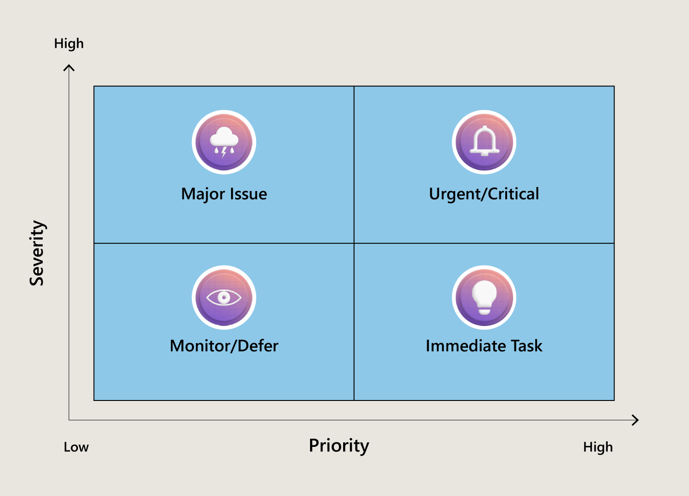

# Bug reports
## The "Rule of 3" - ensuring reproductibility
ensure you are able to **reproduce the bug 3 times in a row** following the described steps.

If it is not possible to reproduce it 3 times, mark the bug as intermittent in the bug report.

## Essential components of a bug report
1. **Summary (Title)**
    - specific
    - decribes the action, the location and the outcome
    - ex: 'Clicking the "Confirm purchase" button on the checkout page results in a 404 error'

1. **Environment**
    - _operating system_
    - _browser and version_
    - device type
    - _user account_ (if relevant)
1. **Steps to reproduce**
    - clear step by step instructions to reproduce the issue
1. **Expected vs actual results**
    - clearly state the conflict between the expected result and the actual result
    

## Bug severity & priority
**Severity**

    - the _technical impact_ of the bug on the functionality of the software. It is a technical assessment.
    - How badly does this break the code?
    - set by QA analyst or developer based on purely technical mindset
    
**Priority**
    - a business-focused decision: how urgently should this be fixed?
    - how much does this bug matter to us right now?
        - customer imapct
        - revenue impact
        - brand reputation
        - time sensitivity?
    - set by the product owner or business

### Four standard severity levels
| Level | Label | Impact | Workaround available? | Impact |
|-------|-------|--------|-----------------------|--------|
| S1 | Blocker | Core functionality completely broken | No | Release or business operations blocked |
| S2 | Critical | Major feature broken or failing | Yes, but difficult | System usable, but core functionality not working with high risk of user frustration or data loss |
| S3 | Major | Non-critical feature affected | Yes, easily available | defect noticeable and clear flaw, but user can still use the product |
| S4 | Minor | Cosmetic or non-functional issue | N/A | little to no impact on user |

Importance of good severity classification:
- developers prioritze effectively
- managers get realistic picture
- credibility grows

### Three levels of priority
- **High** - fix immediately. To be adressed in current or next release.
- **Medium** - important but not an emergency. Schedule for a future planned release.
- **Lox** - "Nice to have" fix. Place it in the backlog and address it when time permits

|  | Low priority | High priority |
| -- | -- | -- |
| High severity | Major issue | Urgent/Critical |
| Low severity | Monitor / defer | Immediate task |

|  | Low priority | High priority |
| -- | -- | -- |
| High severity | Defer / do not fix | Immediate fix |
| Low severity | Add to backlog | Fix quickly |

## QA Metrics and monitoring
### Mean Time To Resolution (MTTR)
the average time elapsed between the bug reporting and its resolve time.
=> can indicate bottlenecks in testing or development processes
### Reopen rate
high number that can indicate
- incomplete fix
- regression introduced
- not verified by QA team
### Actions
- clear bug reports
- rigorous retesting

=> track the bugs you reported to see how well you do in bug reporting

