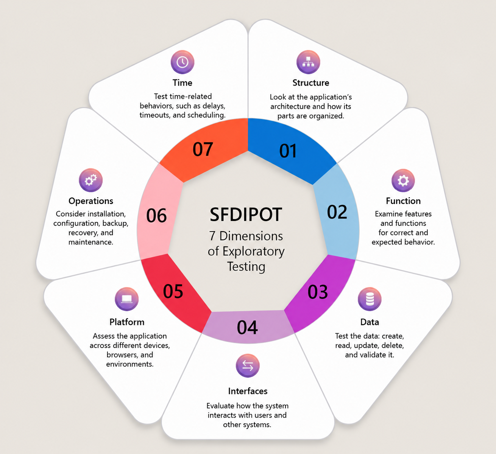

# Exploratory testing
=> unscripted testing

process with 3 activities in the same time:
- **learning** the system
- **designing** test cases
- **executing** those test cases

## Staying focussed with charters
**charter** = a clear, concise mission for the testing session.
in the following format:
**Explore [Target System] with [Ressources] to discover [Information]**
ex: Explore the user registration with a list of common invalid inputs to discover potentially security vulnerabilities.
To be done in general in 15-30 minutes.

## Using Heuristics to find bugs
**heuristics** = rules of thumb / simple strategies to decide how to look:
- **Goldilocks Testing**: testing values at, below and above expected limits to uncover edge-case defects.
- **Interruption Testing**: how does the application handles interruptions?
- **Rapid input**
- **Follow the data**: using CRUD
- **SFDIPOT**: explore different perspectives on the application
    + _Structure_ the application architecture and organisation of the different parts
    + _Function_ testing the features and functions are correctly functionning
    + _Data_ CRUD
    + _Interfaces_ how system interacts with users and other systems
    + _Platforms_ testing on different devices, browsers and environments
    + _Operations_ installation, backup, recovery and maintenance
    + _Time_ time related behavious (delays, timeouts...)
 

