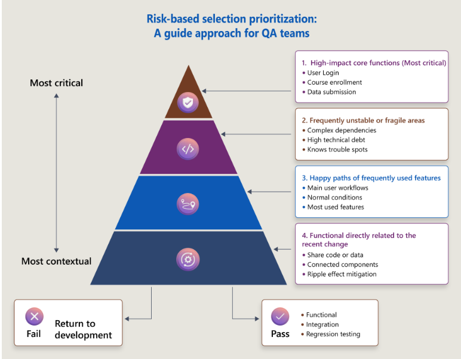

# Regression tests
- Is existing code still working?
- done by QA team
- 2nd step after smoke tests
- regression checklist must be reviewed regularly

## Tiered approach
### Full regression test suite
- primary list with every test case for the entire application
- highest level of test coverage possible
- only for significant events such as full version release

### Partial regresion test suites
- smaller, carefully selected list of test cases for minor releases, patches and hotfixes
- designed to run quickly
- checks only the critical parts of the application

## Risk-based selection
how to select tests for the partial regression test suite?
- **high-impact core functions**
    + critical features
    + should always be part of a partial regression test run
- **Frequenlty unstable or fragile areas**
    + the fragile areas of the application
    + more likely to be affected by nearby changes
- **Happy path of frequently used features**
    + checks the primary workflow of the most-used features is still working correctly
- **Functions directly releated to the recent change**
    + connected components that may be affected by the change because of the ripple effect

## Re-testing
- **re-testing** = confirmation testing
    + narrow and targeted
    + tests if a bug is fixed
- **regression testing**
    + broad
    + check there is no impact from the new code on the old codeoui

# UATs
+ does the new feature work as the user expect? is it useful?
+ done by the user / product owner
+ 3rd step after regression testing (and before approval of the release)